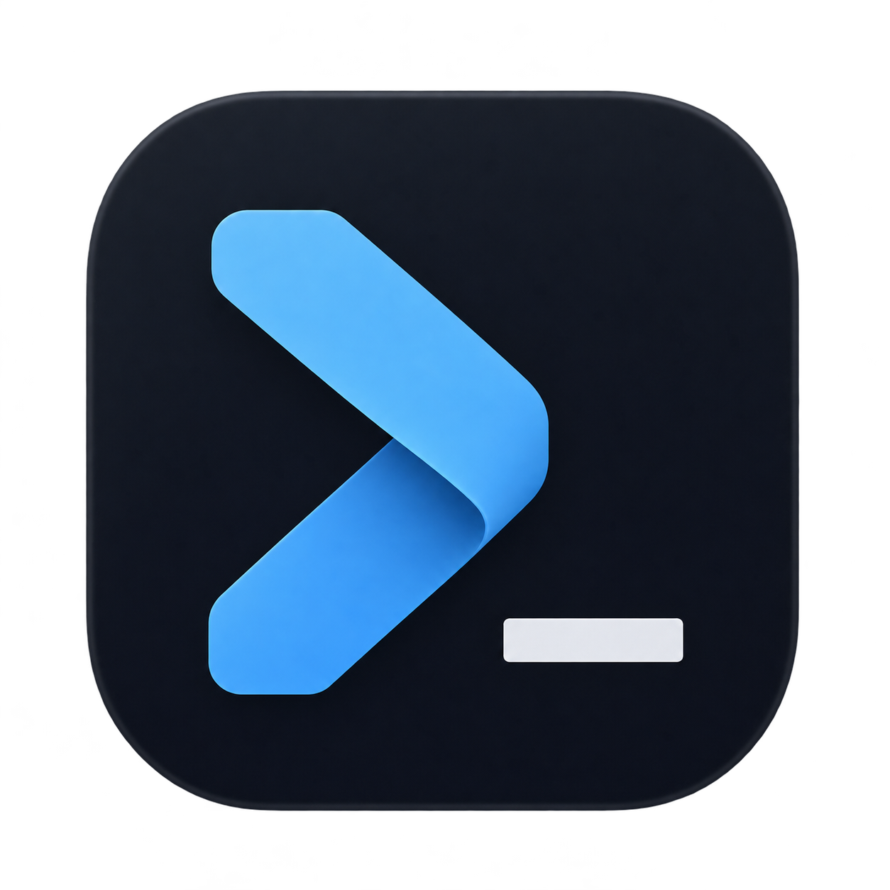

# Rewarp



A native macOS terminal with command blocks, a dedicated input editor, and no AI.
Built on [libghostty-vt](https://github.com/ghostty-org/ghostty) with a hand-written
Metal renderer. See [docs/design.md](docs/design.md) for how it works and why.

## Status

Early, at version 0.0.1. What works today:

- Command blocks with exit status, duration, bookmarks, copying, reinput, find and
  filtering, and a sticky header for long output
- An editor for the input, with syntax highlighting, suggestions from history, and
  completions for commands, files, git refs, ssh hosts, package scripts and make
  targets
- Command and navigation palettes
- Tabs that reorder and sit on the top, left or right, and panes that split, resize
  and maximize
- Full-screen programs, mouse reporting and synchronized output

Blocks and the input editor need shell integration, which only zsh has so far. Other
shells run as a plain terminal.

Not built yet: settings, themes, bash and fish integration, session restore,
workflows, launch configurations, Vim keybindings, inline images and the code
features. [Known limits](docs/design.md#known-limits) lists what to watch out for.

## Build

You need macOS 14 or later, Swift 6 or later, Zig 0.17.0, Python 3, and the Xcode
Command Line Tools. Full Xcode isn't required. The app uses Swift 5 language
mode; tests use Swift Testing from the Swift 6 toolchain.
The deployment target is macOS 14; automated validation currently runs on macOS 15.

```bash
brew install zig
zig version  # use 0.17.0, the version pinned in CI
swift --version
```

The build checks the Zig version pinned in `scripts/ghostty-version.env`. If
Homebrew provides another version, install the pinned toolchain from
[Zig's downloads](https://ziglang.org/download/) and put its directory on `PATH`.

Build the app and open it:

```bash
make run
```

Run `make` on its own to list every command. The main ones:

| Command | What it does |
| --- | --- |
| `make build` | Debug binary |
| `make release` | Optimized binary |
| `make app` | `dist/Rewarp.app` |
| `make icons` | Regenerate the app icon from its source artwork |
| `make install` | Copies the app to `/Applications` |
| `make zip` | `dist/Rewarp-<version>.zip` |
| `make dmg` | `dist/Rewarp-<version>.dmg` |
| `make package` | Both the zip and the disk image |
| `make clean` | Removes build output, keeping libghostty-vt |
| `make distclean` | Removes everything that can be rebuilt |

The first build also downloads and compiles libghostty-vt, which takes a couple of
minutes and needs network access to GitHub and Ghostty's dependency mirrors.
The Ghostty commit is pinned in `scripts/ghostty-version.env`; its C API is
unstable. The app version is set in `Sources/RewarpCore/Version.swift`.

Packages are signed ad hoc for local development and built for the host CPU.
Public binary distribution still needs Developer ID signing, notarization and
testing on another Mac; see [releasing](docs/releasing.md).

## Shortcuts

These are Warp's defaults. The menus list the rest.

| Shortcut | Action |
| --- | --- |
| `⌘T` / `⌘W` | New tab / close the pane or tab |
| `⌘⇧T` | Reopen a closed tab |
| `⌘1` to `⌘9` | Go to a tab |
| `⌘D` / `⌘⇧D` | Split right / split down |
| `⌘[` / `⌘]` | Previous / next pane |
| `⌘⇧↩` | Maximize a pane |
| `⌘P` / `⌘⇧P` | Command palette / navigation palette |
| `⌘F` / `⌥⇧F` | Find / filter a block |
| `⌘↑` / `⌘↓` | Select the previous / next block |
| `⌘B` / `⌘I` | Bookmark / reinput a block |
| `⌘⇧C` / `⌘⌥⇧C` | Copy a block's command / output |
| `⌘K` / `⌘L` | Clear the blocks / focus the input |
| `⌃R` | Search history |

## Test

Unit tests, including ones that run a real zsh:

```bash
make test
```

End-to-end tests drive the real app with synthesized input, invisibly. They use a
private pasteboard and a throwaway `HOME`, so they don't touch your clipboard or
dotfiles.

```bash
make e2e
```

`make check` runs both, and `FILTER=name` narrows either one.
GUI tests need a logged-in macOS graphical session and Metal. CI runs unit tests
and verifies a release app bundle. The security workflow runs UI security
regressions; the CI workflow can also run the full GUI suite on demand.

See [contributing](CONTRIBUTING.md) for the development workflow.

Security regressions, release isolation, sanitizer mutation testing, dependency
monitoring, and analyzer setup are described in [docs/security.md](docs/security.md).
Run `make fuzz` on macOS for the longer terminal mutation campaign, or `make secrets`
to scan all locally fetched Git history and non-ignored source for credentials.

## Parity with Warp

[docs/warp-parity.md](docs/warp-parity.md) lists every non-AI Warp behaviour found
in Warp's public docs, 1,647 in all, and is the definition of done. A box is ticked
only by a passing end-to-end test whose name carries the item's ID, such as
`test_blk_032_click_selects_block`. The checklist currently has 104 ticked. A full
`make e2e` prints the current count.

## Performance

Historical measurements on one Mac timed a `cat` of 256 MB, keeping 50,000 rows
of scrollback, against Ghostty 1.4.0 on its default config:

| Test | Rewarp | Ghostty |
| --- | --- | --- |
| Scrolling output | 183 to 196 MB/s | 160 to 181 MB/s |
| Full-screen repaint | 176 to 187 MB/s | 142 to 155 MB/s |

To repeat it, run `make bench` for scrolling, or `make bench MB=256 KIND=repaint`.
These measurements predate enabling Swift safety checks and Zig `ReleaseSafe`.
Current performance needs to be remeasured. Keypress latency and Warp itself
haven't been measured yet.

## Layout

| Path | What's there |
| --- | --- |
| `Sources/RewarpCore` | Sessions, blocks, layout, completion and history, with no UI |
| `Sources/Rewarp` | The AppKit app and the Metal renderer |
| `Sources/CGhosttyVT` | The C target that links libghostty-vt |
| `resources/shell-integration` | The zsh hooks |
| `tests-e2e` | Tests that drive the real app |
| `docs` | The design and the parity checklist |

## Security and privacy

Rewarp is experimental. It reads local shell history and completion data, and
keeps terminal output in memory. There is no app telemetry or account service.
Your shell startup files and commands run with your user privileges and may
have their own network activity and history settings. See
[SECURITY.md](SECURITY.md) for the trust model, local automation interfaces,
resource limits and private vulnerability reporting.

## License and provenance

Rewarp is licensed under [MIT](LICENSE). The app links libghostty-vt and bundles
JetBrains Mono Nerd Font; see [third-party notices](THIRD_PARTY_NOTICES.md).
Rewarp is an independent project, unaffiliated with Warp or Ghostty. Its stated
approach is to implement behavior from public documentation and app usage.
Please do not copy Warp source or proprietary assets into contributions.

[Design](docs/design.md) · [Contributing](CONTRIBUTING.md) ·
[Governance](docs/governance.md) · [Release preparation](docs/releasing.md) ·
[Publication review](docs/public-release-review.md)
